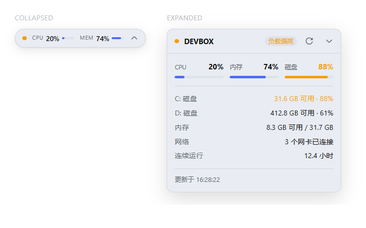

# dsh-windows-monitor

English | [简体中文](README.zh.md)

[](https://github.com/joyboy-yy/dsh-windows-monitor/actions/workflows/ci.yml)
[](LICENSE)

A system monitor overlay for [DeepSeek Harness](https://github.com/deepseek-ai/deepseek-harness): a compact pill in the bottom-right corner showing live CPU and memory, expanding into a detail card with disk activity and throughput, per-volume capacity, network state, uptime and battery.

Runs on **Windows**.



## Features

- **Never covers the middle.** Collapsed it is a ~210 px pill; expanded it is a 280 px card. It sits clear of the composer by default.
- **Draggable.** Drag the pill or the card header anywhere; the position is clamped to the viewport and remembered. A reset control returns it to the corner.
- **Live at a glance.** The status dot is colour-coded — green nominal, amber elevated, pulsing red for collection failure.
- **Detail on demand.** CPU, memory and **disk activity** as bars, plus one row per volume, a memory total, adapter state, uptime and battery.
- **Capacity and activity are never conflated.** The 磁盘 gauge is *busy time* — the same figure as Task Manager's own 磁盘 column, computed as `100 − PercentIdleTime`. Fullness is a separate per-volume row. A static "93% full" number sitting next to a live CPU reading reads as a stuck or broken dial, so it is never what the gauge shows.
- **Unknown is a real state.** Disk activity is best-effort: with no performance-counter provider, or before the first sample, the panel renders `--` rather than `0%`. A zero would be a claim about an idle disk that nothing actually measured.
- **Honest failure states.** A failed collection shows "unavailable" in the pill instead of stale numbers; a platform with no collector says so explicitly rather than looking broken.
- **Theme-native.** Every colour is a DSH theme token, so light and dark mode follow the app. Icons are inline SVG from the harness's own icon set — no icon fonts.
- **Accessible.** Real buttons with labels, visible focus rings, and animations disabled under `prefers-reduced-motion`.

## Requirements

- DeepSeek Harness with the **Web** profile and the current profile-bundle system.
- **Windows.** The host process must be running on Windows; see [Platform support](#platform-support).
- Node.js `^22.19.0 || >=24.0.0` (to build from source).

No administrator rights are needed, and nothing is installed system-wide.

## Platform support

Windows only, and that is deliberate. The plugin is named for Windows, its headline reading (disk activity) comes from a Windows performance counter, and a collector the maintainer cannot run is a collector whose bugs they cannot reproduce. Shipping Linux and macOS collectors that were written from documentation — and that the author could never exercise on their own hardware — traded a promise the project could not keep for two code paths it could not maintain.

The host picks the collector from `process.platform`, never from the request.

| Platform | Collector |
|---|---|
| **Windows** | PowerShell + CIM/WMI (`Win32_Processor`, `Win32_OperatingSystem`, `Win32_LogicalDisk`, `Win32_Battery`, `Win32_PerfFormattedData_PerfDisk_PhysicalDisk`) and `Get-NetAdapter`. Verified by the author on Windows 11 |
| **Anything else** | None. The route answers `501` with an explicit unsupported-platform body, and the panel renders that instead of empty gauges |

`linux` and `macOS` collectors did ship in `0.1.0`; they were removed in `0.2.0`. See the [changelog](CHANGELOG.md).

CI still runs on all three runners, and that is also deliberate. `windows-latest` exercises the collector for real, while `ubuntu-latest` and `macos-latest` prove the negative contract: with no collector the plugin must answer the error rather than pretend. See [`.github/workflows/ci.yml`](.github/workflows/ci.yml).

Known limitations:

- Disk activity needs the Windows performance-counter provider. On a host where it is disabled or missing, the reading degrades to `--` instead of failing the snapshot.
- The collector pins the process culture to invariant. The fact format is `key=value` with `.` as the decimal separator, so a comma-decimal locale would otherwise emit unparseable numbers.
- Some drivers report `PercentDiskTime` several times above 100, which is why busy time is derived from the idle complement instead.

## Install

From npm — prebuilt, and the only path that needs no build permission:

```powershell
dsh plugin --profile web add dsh-windows-monitor
```

From a local checkout — this is the path to use while developing:

```powershell
dsh plugin --profile web add D:\path\to\dsh-windows-monitor
dsh --profile web --dump-config   # confirm the windows-monitor row is composed
dsh --profile web
```

From a release tarball (prebuilt, no build permission needed):

```powershell
dsh plugin --profile web add .\dsh-windows-monitor-0.1.0.tgz
```

From a pinned source tag:

```powershell
dsh plugin --profile web add github:joyboy-yy/dsh-windows-monitor#v0.1.0
```

A git install fetches source and runs this package's `prepare` build, which means package code executes on your machine outside the agent sandbox. pnpm refuses that until the profile's `pnpm-workspace.yaml` explicitly allows it:

```yaml
allowBuilds:
  dsh-windows-monitor: true
```

Read the source and pin a tag before granting that. A release tarball ships prebuilt files and needs no such permission.

## Configuration

This bundle inserts one Host/Client row, declared in [`cordis.patch.yml`](cordis.patch.yml):

```yaml
- insert:
    - id: windows-monitor
      name: dsh-windows-monitor
      inject: [shell, sandboxPolicy, webServer]
```

Override that row in your profile or home `cordis.patch.yml` to disable it or change its position in the tree.

Browser-local preferences are limited to one value: the dragged panel position, stored under the `dsh-windows-monitor:position` `localStorage` key. It is written only when you drag the panel and removed when you press reset. The plugin stores no metrics.

## How it works

The **Host half** registers one read-only route and runs the collector for its own platform through the harness `shell` service:

```
GET /api/windows-monitor/snapshot
```

The collector prints one `key=value` fact per line. A line format — rather than JSON — is deliberate: emitting correct JSON from PowerShell without assuming a JSON library is a portability trap, whereas `key=value` is trivial to produce and trivial to parse (and unit-test) on the TypeScript side. The host converts facts into the snapshot the client renders and stamps the timestamp itself.

Results are cached for 5 seconds, and concurrent polls share a single in-flight collection instead of racing, so the browser's polling never multiplies collector runs.

The **Client half** registers into the frame-wide `shell.overlay` slot. That layer is click-through by design — the panel opts into pointer events, so it never blocks the app underneath.

Neither half touches the model, the session, or the transcript. The plugin registers no tools.

## Security model

Read this before installing.

- **The collector is read-only.** It reads CIM/WMI and runs `Get-NetAdapter`. Nothing writes, installs, or changes machine state.
- **The sandbox grant is broad.** The Host half resolves the `danger-full-access` sandbox policy so the shell can run. The commands are read-only, but the policy is not — it is the main thing to review, and it lives in `src/index.ts` and `src/collectors/`.
- **The command is chosen by the host, not the browser.** The platform comes from `process.platform`; a request cannot select a different collector.
- **The payload carries no personal data.** It contains the host name, CPU percentage, memory totals and usage, per-volume capacity and usage, disk busy time and read/write throughput, a connected-adapter count, uptime hours, and battery percentage when a battery exists. No file contents, no usernames, no paths, no credentials, and no per-process or per-file disk attribution.
- **No network egress.** The plugin makes no outbound requests. Its only HTTP surface is the local route served by the harness on your machine.
- **No secret material.** The plugin never reads credentials.
- **Cache-Control: no-store** on every response.
- **One localStorage key**, holding only the panel position.

## Development

```powershell
pnpm install
pnpm run typecheck
pnpm run test
pnpm run build
```

`pnpm run test` runs the parser suite everywhere plus the collector integration test on Windows. On any other platform it instead asserts the unsupported-platform contract — that `selectCollector` returns nothing and the route answers `501` rather than serving empty gauges. CI covers both.

`pnpm run build` produces `lib/index.js` + `lib/index.d.ts` (Host, ESM) and `lib/client.js` + `lib/client.js.map` (Client, wrapped in the `window.__ModuleLoader__` envelope the harness expects).

`lib/` is committed on purpose: the harness activates a plugin by reading `lib/client.js` from disk, and a GitHub install does not necessarily run a build. CI fails if the committed `lib/` drifts from a clean build.

The client bundle must never inline React. `tsdown.config.ts` marks `react` and `react/jsx-runtime` as never-bundle so they resolve from the harness module table.

The collector scripts are JavaScript template literals, so a literal `${` would be interpolated at build time and silently corrupt the shell script — `tests/collectors.test.ts` guards against that. For the same reason a stray backtick inside a script terminates the literal early; that one fails loudly at build time rather than at collection time, so it needs no test.

## Contributing

Issues and pull requests are welcome. [CONTRIBUTING.md](CONTRIBUTING.md) covers the build, test and verification workflow; security-relevant reports go through [SECURITY.md](SECURITY.md).

The scope is intentionally Windows-only, so the most useful contributions are Windows ones: a machine where the performance-counter provider is unavailable, a locale other than en-US or zh-CN, a Windows build where a CIM class behaves differently. A report with the raw `key=value` output is enough to work from.

## License

[MIT](LICENSE)
